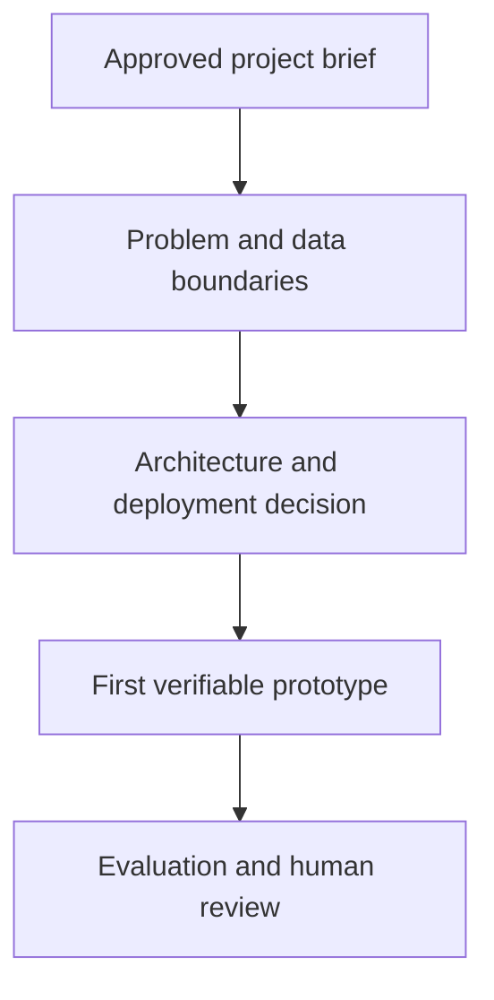

# DUBAI-NEXUS-AI

[](#proof-of-concept--enterprise-customization-readiness)

**DUBAI-NEXUS-AI is currently an unscoped repository placeholder.** The default branch contains only this README; no product brief, application source, architecture, dependencies, tests, CI configuration, or deployment was present in the repository tree during this review.

## 1. Project Overview & Problem Statement

The repository name suggests a possible Dubai-related AI initiative, but no verified project description or problem statement is currently recorded. This README intentionally does not invent a product scope, target customer, business model, or AI capability.

A future project brief should identify the user problem, intended outcome, target geography/sector, and whether the product is a prototype, research project, or commercial service.

## 2. Tech Stack & Versions

No programming language, framework, model, runtime, database, or supported version is declared.

## 3. Prerequisites & Dependencies

No development prerequisites or runtime dependencies are currently defined.

## 4. Installation & Local Setup

Clone the repository:

```bash
git clone https://github.com/zopair/DUBAI-NEXUS-AI.git
cd DUBAI-NEXUS-AI
```

There is no application to install or run.

## 5. Environment Variables

No environment variables, secrets, API keys, or runtime settings are defined.

## 6. Usage Guide & Core Features

No product features or executable workflows are implemented. The repository name alone is not evidence of an AI model, autonomous agent, Dubai market integration, or live business service.

## 7. Live Demo & Screenshots

No live application, API, or demo is deployed.

## 8. Testing & Verification

No source code, automated tests, CI workflow files, or deployment checks are present in the current default-branch tree.

Historical GitHub Actions runs exist in repository history, but the workflow definitions are not present in the current tree and cannot be reproduced from the current source snapshot.

## Proof of Concept & Enterprise Customization Readiness

**Status: Placeholder only — not yet a PoC or MVP.**

| Area | Current state |
|---|---|
| Product brief | Not defined |
| Architecture | Not defined |
| Source code | None |
| Dependencies | None |
| Environment configuration | None |
| Tests / CI | No current workflow or test files |
| Deployment | Not configured |
| Project license | No root `LICENSE` file present |

The next engineering step is a documented product brief and architecture decision before selecting tools or adding implementation.

## Intellectual Property & Authorship

Requested repository attribution: **Aly Hussein Zopair (علي حسين زبير ALY HUSSEIN ZOPAIR)**.

This attribution does not create a software license or claim rights over third-party components that may be added later.

## Conceptual Architecture

No architecture or AI capability is currently implemented. This diagram records the minimum decision sequence before selecting a model or service:



## Change log

- 2026-11-28 — Added a conceptual decision flow and documentation baseline. No product features or integrations were claimed.
